# LAB_HARBOR.md – Gestion des Images Docker avec Harbor

> **Étudiant C – Expert Harbor**
> **Projet : Construction d'une Chaîne CI/CD Sécurisée**
> Classe : Mastère CCDAD – M1 | Enseignant : Hedi MAGROUN

---

## Objectif du lab

Mettre en place un registre privé Docker avec Harbor afin de stocker, 
gérer et distribuer des images Docker dans une chaîne CI/CD sécurisée.

---

# 1. Le Besoin – Pourquoi utiliser Harbor ?

Harbor c'est pour stocker les images Docker de manière sécurisée,

docker utilise DockerHub qui est un registre public.
Harbor permet de créer un registre privé.

### Différence DockerHub vs Harbor

| DockerHub          | Harbor                          |
|--------------------|---------------------------------|
| registre public    | registre privé                  |
| hébergé par Docker | hébergé localement              |
| images publiques   | images privées sécurisées       |

---

# 2. Concepts Clés

### 2.1 Docker Image

c'est un modéle en lecture seule qui contient tout ce qu'il faut pour faire tourner 
une application (Dockerfile).

### 2.2 container

c'est une image qui tourne. c'est l'instance vivante de l'image on lance 
un container depuis l'image.

```bash
docker ps
```

pour voir les containers qui tourne.

### 2.3 registry

c'est un serveur de stockage d'image docker. c'est l'endroit ou on envoie les images
pour les conserver, les partager et les récupérer depuis n'importe quel machine.

**action : pull , push**

### 2.4 Harbor

harbor est un registre privé open-source développé pour les environnements DevOps et 
CI/CD.

### 2.5 Architecture de fonctionnement

```text
Dockerfile + code source
            │
            ▼
docker build
(creation image Docker)
            │
            ▼
Harbor Registry
(stockage image)
            │
            ▼
docker pull
(téléchargement image)
            │
            ▼
container Docker exécuté
```

---

# 3. Mise en Place Technique – Installation

## 3.1 Prérequis

- Docker installé
- Docker Compose installé

verification :

```bash
docker --version
docker compose version
```
---

## 3.2 Téléchargement de Harbor

donc d'apres github j'ai installer Harbor:

```bash
wget https://github.com/goharbor/harbor/releases/download/v2.14.4/harbor-online-installer-v2.14.4.tgz
```
<p align="center">
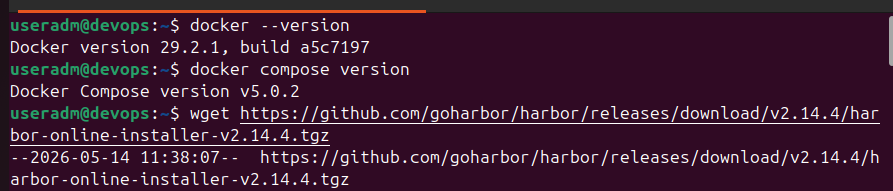
</p>
extraction :

```bash
tar xvf harbor-online-installer-v2.14.4.tgz
```
<p align="center">
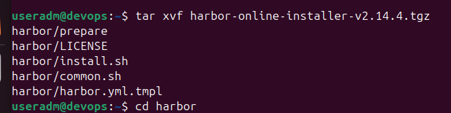
</p>
---

## 3.3 Configuration Harbor

création du fichier de configuration :

```bash
cp harbor.yml.tmpl harbor.yml
```

le fichier `harbor.yml.tmpl` représente le modèle de configuration fourni par Harbor.

le fichier `harbor.yml` correspond à la configuration réelle utilisée lors de l’installation.

modification :

```bash
nano harbor.yml
```

configuration utilisée :

```yaml
hostname: 10.0.2.15 (ip machine)

http:
  port: 8088 (car quand j'ai essayer d'utiliser le port 80 il est utilisé par
              jenkins donc j'ai modifié le port)
```
<p align="center">
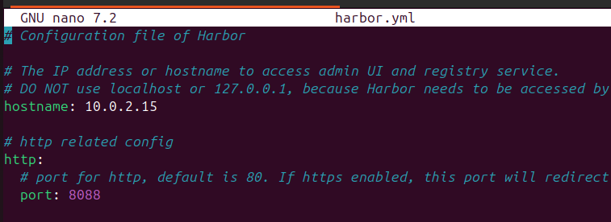
</P>
<p align="center">
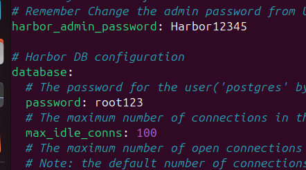
</p>

dans harbor.yml j'ai décommenté la partie de https, car lors de poursuivre la 
documentation d'instalatio harbor il m'a donné une etape d'utiliser HTTPS 
mais il est pour les grands entreprise puisque je vais travailler dans mon local
je vais utiliser HTTP pour simplifier les choses.

---

## 3.4 Installation Harbor

```bash
sudo ./install.sh
```
<p align="center">
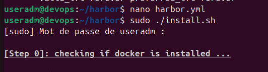
</p>

verification des conteneurs :

```bash
docker ps
```

aussi puisque j'utilise http donc il faut ajouter harbor comme insecure registry
car Docker refuse de communiquer avec un registre non sécurisé.

dans `/etc/docker/daemon.json` :

```json
{ "insecure-registries" : ["10.0.2.15:8088"]}
```
<p align="center">
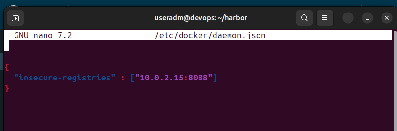
</p>

donc apres ca j'ai redemarer docker

apres l'instalation de nouveau se reussi
j'ai acceder a l'interface web avec:

```text
http://10.0.2.15:8088
```

### Interface Harbor
<p align="center">
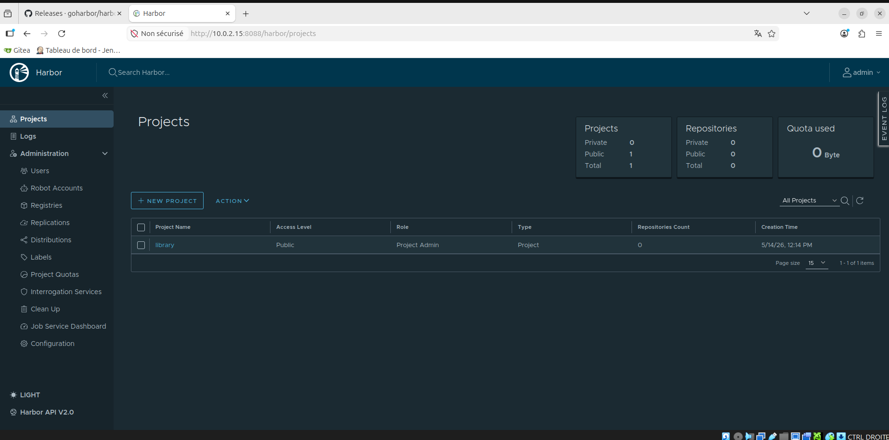
</p>
---

# 4. Création d’un Projet Harbor

depuis l’interface web Harbor :

```text
Projects → New Project
```

Projet créé :

```text
dev-project
```

Type :

```text
Private
```

### Projet Harbor créé
<p align="center">
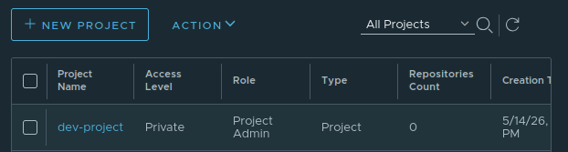
</p>
---

# 5. Création et Push d’une Image Docker

## 5.1 Création d’une application simple

Fichier `index.html` :

```html
<h1>salut Harbor CI/CD Projet</h1>
<p>Docker image cree par moi Nour</p>
```

---

## 5.2 Dockerfile

```dockerfile
FROM nginx:alpine

COPY index.html /usr/share/nginx/html/index.html
```

---

## 5.3 Build de l’image Docker

```bash
docker build -t myapp:v1 .
```

### Build image Docker
<p align="center">
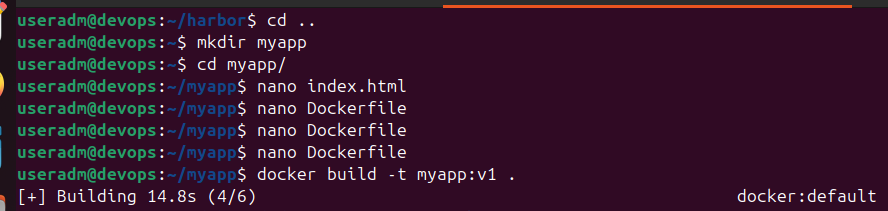
</p>
<p align="center">
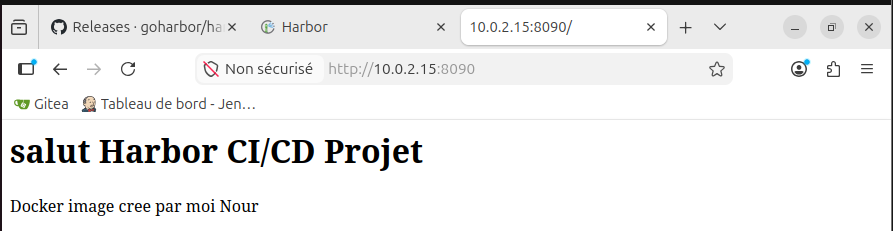
</p>
---

## 5.4 Login Harbor

```bash
docker login 10.0.2.15:8088
```

---

## 5.5 Tag de l’image

```bash
docker tag myapp:v1 10.0.2.15:8088/dev-project/myapp:v1
```
<p align="center">
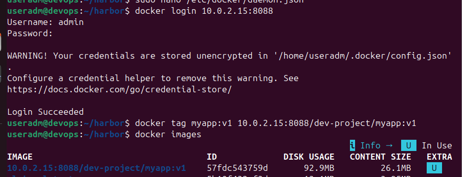
</p>
---

## 5.6 Push de l’image vers Harbor

```bash
docker push 10.0.2.15:8088/dev-project/myapp:v1
```

Après le push, l’image apparaît dans :

```text
Projects → dev-project → Repositories
```

### Push image vers Harbor
<p align="center">
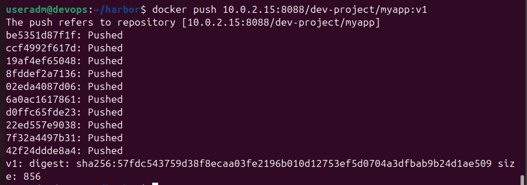
</p>
### Harbor Repository
<p align="center">
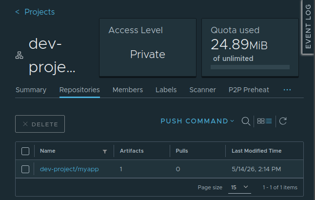
</p>
---

## 5.7 Supprimer l’image de chez moi

=> j'ai supprimer l'image cree pour tester le pull

```bash
docker rmi myapp:v1
```

---

## 5.8 Pull de l’image

```bash
docker pull 10.0.2.15:8088/dev-project/myapp:v1
```

### Pull image depuis Harbor

<p align="center">
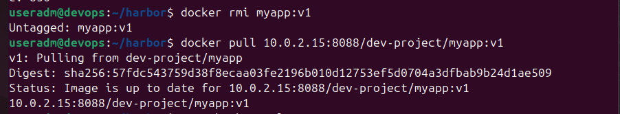
</p>
---

# 6. Captures d’écran

Les captures d’écran utilisées dans ce lab se trouvent dans :

```text
images/
```

---

# 7. Documentation Officielle

- Harbor Documentation : https://goharbor.io/docs/
- Docker Documentation : https://docs.docker.com/
