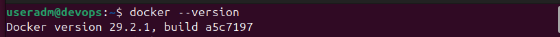
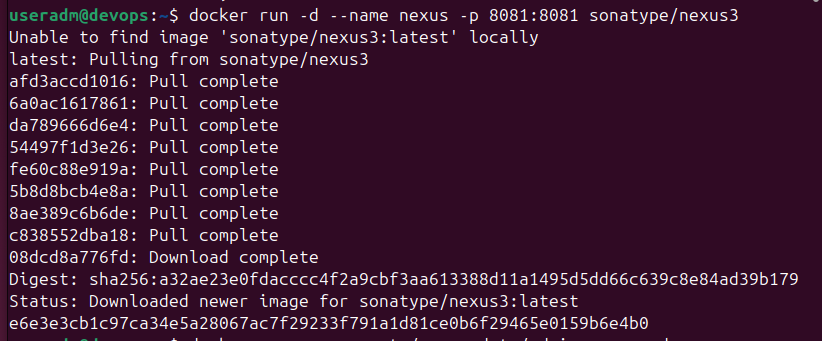
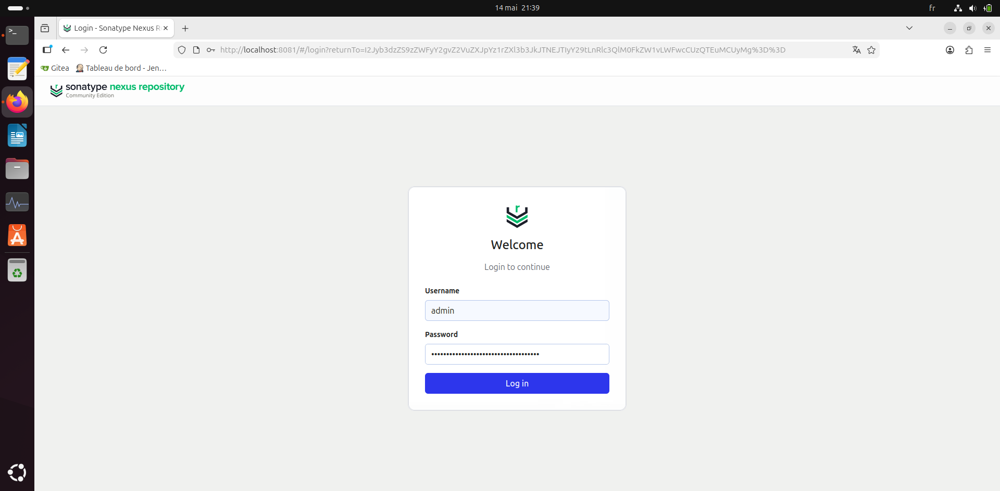
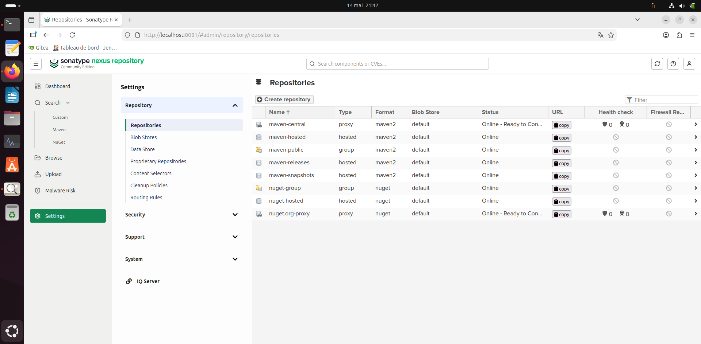
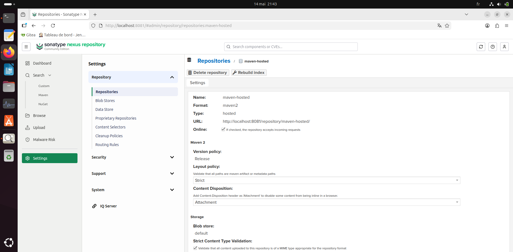
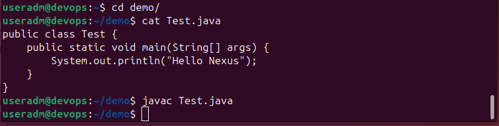
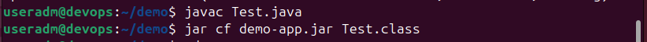

# LAB Nexus Repository

# 1. Introduction

Dans ce laboratoire, nous avons etudie Nexus Repository Manager.

Nexus est un gestionnaire de depots d'artefacts , il sert a stocker , organiser et distribuer les fichiers.

---

# 2. Besoin metier

Dans une entreprise, les developpeurs utilisent plusieurs dependances et generent plusieurs versions d’applications.

Sans Nexus :
	-chaque devellopeur telecharge depuis Internet.
	-Jenkins telecharge aussi.
	-Docker telecharge aussi.

Avec Nexus :
	-Nous telechargent une seule fois.
	-il garde une copie locale
	-tous les devellopeurs utilisent cette copie 

---

# 3. Concepts de base

## 3.1 Artefact

Un artefact est un fichier genere apres la compilation d'une application.

Exemples :
	-fichier .jar .war
	-image Docker

---

## 3.2 Repository Hosted 

Le Repository hosted est un repo local cree dans nexus. 
il sert a stocker:
	-les applications de l'entreprise.
	-builds Jenkins.
	-librairie internes.
	-image docker privees.

---

## 3.3 Repository Proxy

Le repository proxy sert de cache et intermediaire vers internet.

Maven -> Nexus Proxy -> Internet

Quand une dependance demande :
	-Nexus verifie localement 
	-sinon telecharge depuis internet
	-garde une copie cache 

## 3.4 Repository Group

Le repository group permet de regrouper plusieurs repo dans une seule URL.

---

# 4. Architecture Nexus

```text
Développeur / Jenkins
        |
        v
      Nexus
   /     |     \
Hosted  Proxy  Group
        |
        v
<<<<<<< HEAD
 Maven Central# 4. Installation de Nexus
=======
 Maven Central
>>>>>>> 77a9335 (Ajout LAB Nexus avec images)
```

# 5. Installation de Nexus

## 5.1 Installation Docker



## 5.2 Lancer Nexus



## 5.3 Acces à Nexus



## 5.4 Recuperation du mot de passe admin


# 6. Repositories existants



# 7. Creation d’un repository Hosted

Nous avons cree un repository Maven Hosted nomme :



Ce repository permet de stocker les artefacts generes par nos applications.

# 8. Test d’upload d’un artefact

## 8.1 Creation d’une application Java simple



## 8.2 Compilation et generation du fichier JAR



## 8.3 Upload dans Nexus

<<<<<<< HEAD
=======
Nous avons uploade le fichier demo-app.jar dans le repository maven-hosted en utilisant l’interface Nexus :

- selection du fichier
- ajout des coordonnées Maven (groupId, artifactId, version)
- validation de l’upload

>>>>>>> 77a9335 (Ajout LAB Nexus avec images)
# 9. Résultat

Le fichier 'demo-app.jar' a été stocké avec succes dans le repository 'maven-hosted'.

# 10. Conclusion

Ce laboratoire nous a permis de :
	- comprendre le rôle de Nexus
	- comprendre les différents types de repositories
	- installer Nexus avec Docker
	- créer un repository Hosted
	- publier un artéfact Java dans Nexus

# 11. Références

- https://help.sonatype.com/en/nexus-repository-manager.html
- https://hub.docker.com/r/sonatype/nexus3
