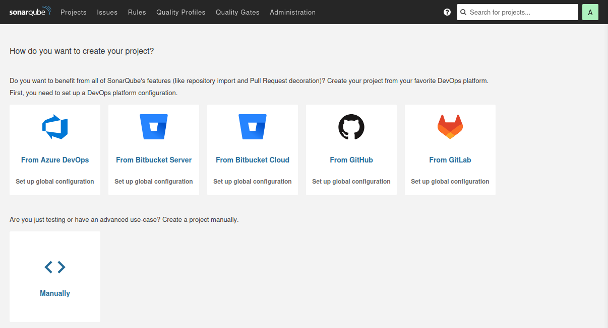
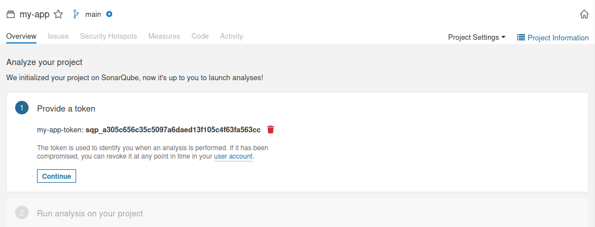
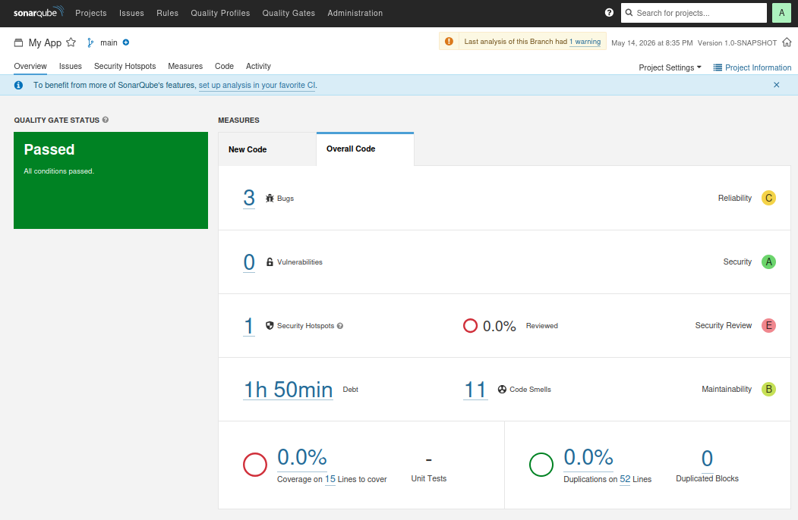
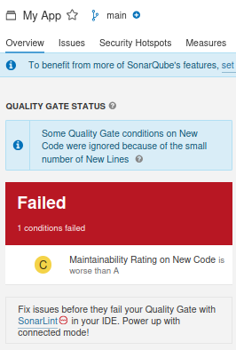

# LAB_SONARQUBE.md – Analyse de la Qualité du Code

> **Étudiant A – Expert SonarQube**
> **Projet : Construction d'une Chaîne CI/CD Sécurisée**  
> Classe : Mastère CCDAD – M1 | Enseignant : Hedi MAGROUN

---

## Objectif du lab

Mettre en évidence les capacités de SonarQube à détecter automatiquement les bugs, vulnérabilités et code smells dans une application Java Maven.

---

## 1. Le Besoin – Pourquoi analyser le code ?

Dans un projet logiciel, le code peut contenir :

- des **bugs** qui font arrêter l’application,
- des **failles de sécurité** exploitables par des attaquants,
- de la **dette technique** (code difficile à comprendre ou modifier),
- du **code dupliqué** qui complique les évolutions.

Sans outil d’analyse, ces problèmes sont souvent découverts trop tard, après la mise en production, où les corrections coûtent plus cher.

**SonarQube** est la solution : il analyse le code source de façon **statique** (sans l'exécuter) et remonte tous les problèmes automatiquement dans un dashboard centralisé.

### Bénéfices concrets

| Problème sans SonarQube         | Solution avec SonarQube              |
|----------------------------------|--------------------------------------|
| Bugs découverts en production    | Détectés dès le commit               |
| Failles de sécurité non vues     | Identifiées et classées par gravité  |
| Code difficile à maintenir       | Mesuré via la dette technique        |
| Pas de standard de qualité       | Enforced via les Quality Gates       |

---

## 2. Les Concepts Clés

### 2.1 Quality Gate

Un **Quality Gate** est un ensemble de règles qui décide si le projet respecte le niveau de qualité attendu.

- **PASS** → le code peut être déployé
- **FAIL** → le pipeline est bloqué

Exemple de règles :

| Critère               | Seuil minimum |
|-----------------------|---------------|
| Bugs critiques        | 0             |
| Vulnerabilities       | 0             |
| Couverture de tests   | ≥ 80%         |
| Duplication de code   | < 5%          |

### 2.2 Clean as You Code

Concept recommandé par SonarSource : on contrôle **uniquement le nouveau code** plutôt que tout le projet.

**Pourquoi ?** Un vieux projet peut déjà avoir de la dette technique accumulée. L'objectif est de ne pas aggraver la situation et de garder le nouveau code propre dès le départ.

### 2.3 Les Scanners

Un **Scanner** est l'outil qui lit le code source et envoie les résultats au serveur SonarQube.

| Scanner                  | Utilisation                        |
|--------------------------|------------------------------------|
| `sonar-maven-plugin`     | Projets Java/Maven                 |
| `sonar-scanner` CLI      | Tout type de projet                |
| SonarScanner for Gradle  | Projets Gradle                     |
| SonarScanner for Jenkins | Intégration CI/CD (Semaine 2)      |

### 2.4 Types de problèmes détectés

| Type                 | Description                               | Exemple                              |
|----------------------|-------------------------------------------|--------------------------------------|
| **Bug**              | Erreur logique pouvant causer un crash    | `NullPointerException`, `==` sur String |
| **Vulnerability**    | Faille de sécurité exploitable            | SQL Injection, mot de passe hardcodé |
| **Code Smell**       | Mauvaise pratique nuisant à la lisibilité | Variable inutilisée, catch vide      |
| **Security Hotspot** | Code à risque nécessitant une revue       | Usage de `Random` pour crypto        |

### 2.5 Architecture de fonctionnement

```
Code Source (Java/Maven)
        │
        ▼
sonar-maven-plugin (Scanner)
        │  analyse statique locale
        ▼
SonarQube Server (port 9000)
        │  applique les règles & Quality Gate
        ▼
Dashboard Web → résultats visibles
```

**Sources officielles :**
- [Documentation SonarQube](https://docs.sonarsource.com/sonarqube/latest/)
- [Quality Gates](https://docs.sonarsource.com/sonarqube/latest/user-guide/quality-gates/)
- [Clean as You Code](https://docs.sonarsource.com/sonarqube/latest/user-guide/clean-as-you-code/)
- [SonarScanner for Maven](https://docs.sonarsource.com/sonarqube/latest/analyzing-source-code/scanners/sonarscanner-for-maven/)

---

## 3. Mise en Place Technique – Installation

### 3.1 Prérequis

- Docker installé et démarré
- Java JDK 11+
- Maven installé

Vérifications :

```bash
docker --version
java -version
mvn -version
```

### 3.2 Lancement de SonarQube via Docker

```bash
docker run -d \
  --name sonarqube \
  -p 9000:9000 \
  sonarqube:lts
```

Vérifier que le conteneur tourne :

```bash
docker ps
```

Attendre environ 1 minute que SonarQube démarre, puis accéder à :

```
http://localhost:9000
```

Login par défaut : `admin / admin` → changer le mot de passe au premier login.

<p align="center">
  
</p>

### 3.3 Création du projet et du Token

1. **Projects → Create Project → Manually**
2. **Project Key** : `my-app` | **Display Name** : `my-app`
3. Cliquer sur **Set Up → Locally**
4. **Generate a token** → nommer : `my-app-token`
5. Copier et sauvegarder le token généré

> Le token ne s'affiche qu'une seule fois — le sauvegarder immédiatement.

<p align="center">
  
</p>

---

## 4. Analyse d'une Application Java avec Maven

### 4.1 Structure du projet de test

```
my-app/
 ├── pom.xml
 └── src/
     └── main/
         └── java/
             └── App.java
```

### 4.2 Code Java de test (bugs intentionnels)

```java
import java.util.Scanner;

public class App {

    public static void main(String[] args) {

        Scanner scanner = new Scanner(System.in);

        // CODE SMELL : variable inutilisée
        int unusedVariable = 100;

        System.out.println("Enter username:");
        String username = scanner.nextLine();

        // BUG : mauvaise comparaison de chaînes
        if (username == "admin") {
            System.out.println("Welcome Admin");
        }

        if (username == "admin") {
            System.out.println("Welcome Admin");
        }

        // BUG : risque de NullPointerException
        String password = null;
        System.out.println(password.length());

        // VULNERABILITY : mot de passe hardcodé dans le code source
        String password2 = "admin123";

	try {
	    // BUG volontaire pour tester SonarQube : division par zéro
	    int result = 10 / 0;
	} catch (Exception e) {
	    // Exception ignorée (Code Smell)
	}
    // CODE SMELL
    if (true) {
        System.out.println("Always executed block");
    }
	// CODE SMELL : Scanner jamais fermé → fuite de ressource
    }
}
```

### 4.3 Configuration du pom.xml

```xml
<project>
    <modelVersion>4.0.0</modelVersion>

    <groupId>com.example</groupId>
    <artifactId>my-app</artifactId>
    <version>1.0-SNAPSHOT</version>
    <name>My App</name>

    <build>
        <plugins>
            <plugin>
                <groupId>org.apache.maven.plugins</groupId>
                <artifactId>maven-compiler-plugin</artifactId>
                <version>3.11.0</version>
                <configuration>
                    <source>${maven.compiler.source}</source>
                    <target>${maven.compiler.target}</target>
                </configuration>
            </plugin>

            <plugin>
                <groupId>org.sonarsource.scanner.maven</groupId>
                <artifactId>sonar-maven-plugin</artifactId>
                <version>4.0.0.2929</version>
            </plugin>
        </plugins>
    </build>

</project>
```

### 4.4 Lancement de l'analyse

```bash
mvn clean verify sonar:sonar \
  -Dsonar.projectKey=my-app \
  -Dsonar.host.url=http://localhost:9000 \
  -Dsonar.login=MON_TOKEN_ICI
```

| Argument               | Rôle                                           |
|------------------------|------------------------------------------------|
| `clean`                | Supprime les anciens fichiers compilés         |
| `verify`               | Compile le code et exécute les tests           |
| `sonar:sonar`          | Lance l'analyse et envoie les résultats        |
| `-Dsonar.projectKey`   | Identifiant du projet dans SonarQube           |
| `-Dsonar.host.url`     | URL du serveur SonarQube                       |
| `-Dsonar.login`        | Token d'authentification généré à l'étape 3.3 |

---

## 5. Test et Validation

### 5.1 Résultats attendus dans SonarQube

| Type          | Problème détecté                                   |
|---------------|----------------------------------------------------|
| Bug           | Comparaison `==` sur String (`username == "admin"`)|
| Bug           | `NullPointerException` sur `password.length()`     |
| Security Hotspot | Mot de passe hardcodé (`password2 = "admin123"`)   |
| Code Smell    | Variable `unusedVariable` inutilisée               |
| Code Smell    | Bloc `catch` vide ou sans traitement réel          |
| Code Smell    | `Scanner` jamais fermé                             |
| Code Smell    | Duplication de code (`if (username == "admin")`)   |

→ **Quality Gate : FAIL**

<p align="center">
  
</p>

<p align="center">
  
</p>

### 5.2 Vérification dans le dashboard

1. Aller sur `http://localhost:9000`
2. **Projects → my-app**
3. Vérifier le statut du Quality Gate, le nombre de Bugs/Vulnerabilities/Code Smells, et le détail par fichier et par ligne.

---

## 6. Résumé

| Élément         | Détail                                          |
|-----------------|-------------------------------------------------|
| Outil           | SonarQube LTS Community Edition                 |
| Installation    | Docker `sonarqube:lts` sur port 9000            |
| Scanner utilisé | `sonar-maven-plugin` 4.0.0.2929                 |
| Projet de test  | Application Java avec bugs intentionnels        |
| Quality Gate    | FAIL (Bugs + Vulnerabilities + Code Smells)     |
| Prochaine étape | Intégration Jenkins ↔ SonarQube (Semaine 2)     |

---