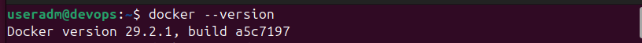
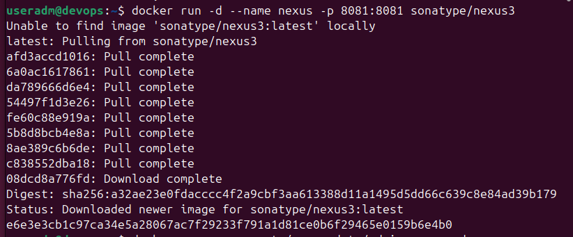
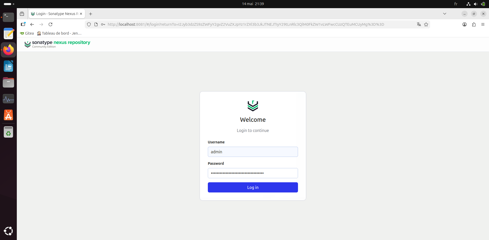
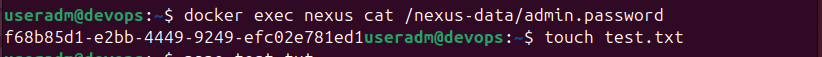
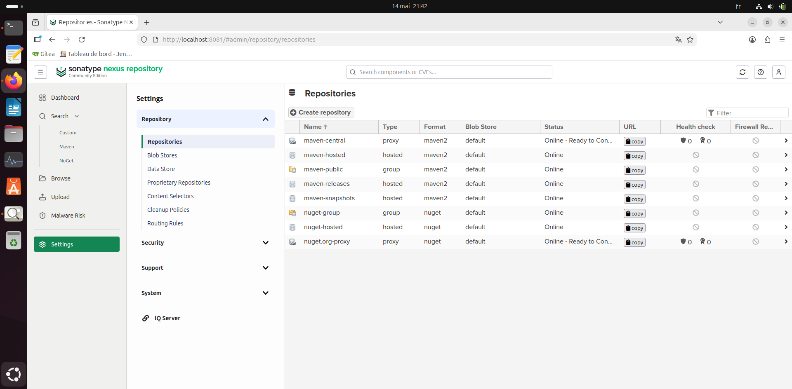
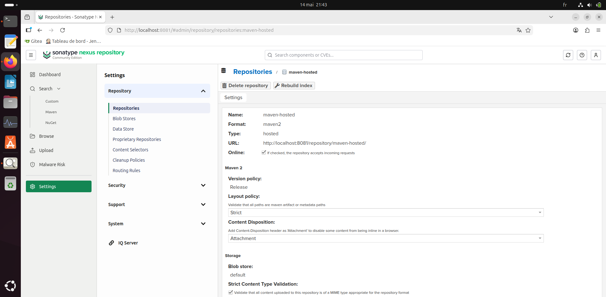
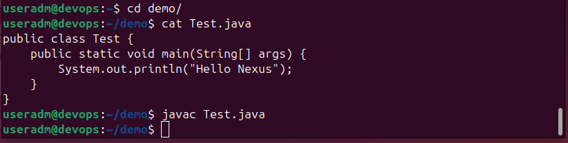
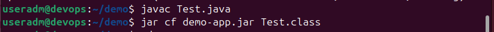

# LAB Nexus Repository

# 1. Introduction

Dans ce laboratoire, nous avons étudié Nexus Repository Manager.

Nexus est un gestionnaire de dépots d'artefacts , il sert a stocker , organiser et distribuer les fichiers.

---

# 2. Besoin metier

Dans une entreprise, les développeurs utilisent plusieurs dépendances et génèrent plusieurs versions d’applications.

Sans Nexus :

	- chaque dévellopeur télécharge depuis Internet.
	- Jenkins télécharge aussi.
	- Docker télécharge aussi.

Avec Nexus :

	- Nous téléchargent une seule fois.
	- il garde une copie locale
	- tous les dévellopeurs utilisent cette copie 

---

# 3. Concepts de base

## 3.1 Artefact

Un artefact est un fichier généré apres la compilation d'une application.

Exemples :

	- fichier .jar .war
	- image Docker

---

## 3.2 Repository Hosted 

Le Repository hosted est un repo local créé dans nexus. 
il sert à stocker:

	- les applications de l'entreprise.
	- builds Jenkins.
	- librairie internes.
	- image docker privees.

---

## 3.3 Repository Proxy

Le repository proxy sert de cache et intermédiaire vers internet.

Maven -> Nexus Proxy -> Internet

Quand une dépendance demande :

	- Nexus vérifie localement 
	- sinon télécharge depuis internet
	- garde une copie cache 

## 3.4 Repository Group

Le repository group permet de regrouper plusieurs repo dans une seule URL.

---

# 4. Architecture Nexus

```text
Développeur / Jenkins
        |
        v
      Nexus
   /     |     \
Hosted  Proxy  Group
        |
        v
 Maven Central
```

# 5. Installation de Nexus

## 5.1 Installation Docker



## 5.2 Lancer Nexus



## 5.3 Accés à Nexus



## 5.4 Récuperation du mot de passe admin



# 6. Repositories existants



# 7. Création d’un repository Hosted

Nous avons créé un repository Maven Hosted nomme :



Ce repository permet de stocker les artefacts générés par nos applications.

# 8. Test d’upload d’un artefact

## 8.1 Création d’une application Java simple



## 8.2 Compilation et génération du fichier JAR



## 8.3 Upload dans Nexus

Nous avons uploade le fichier demo-app.jar dans le repository maven-hosted en utilisant l’interface Nexus :

	- selection du fichier
	- ajout des coordonnées Maven (groupId, artifactId, version)
	- validation de l’upload

# 9. Résultat

Le fichier 'demo-app.jar' a été stocké avec succes dans le repository 'maven-hosted'.

# 10. Intégration CI/CD avec Jenkins et Nexus

## 10.1 Objectif

L’objectif est d’automatiser le déploiement des artefacts vers Nexus en utilisant Jenkins.

---

## 10.2 pom.xml

```xml
<distributionManagement>
    <repository>
        <id>nexus</id>
        <url>http://@IP:8081/repository/maven-snapshots/</url>
    </repository>
</distributionManagement>
```
## 10.3 settings.xml
```xml
<settings>
  <servers>
    <server>
      <id>nexus</id>
      <username>admin</username>
      <password>admin123</password>
    </server>
  </servers>
</settings>
```
## 10.4 Jenkinsfile
```xml
pipeline {
    agent any

    tools {
        maven 'M3'
    }

    stages {

        stage('Build') {
            steps {
                dir('app') {
                    sh 'mvn clean package -DskipTests'
                }
            }
        }

        stage('Deploy Nexus') {
            steps {
                dir('app') {
                    sh 'mvn deploy -DskipTests'
                }
            }
        }
    }
}
```
## 10.5 Résultat CI/CD
- Build automatique avec Jenkins
- Génération du JAR
- Déploiement automatique vers Nexus
## 11. Conclusion
**Semaine 1**
- Comprendre Nexus
- Installer avec Docker
- Créer un repository hosted
- Uploader un artefact

**Semaine 2**
- Intégration Jenkins + Nexus
- Automatisation Maven
- Pipeline CI/CD complet

---

## 12. Références

- https://help.sonatype.com/en/nexus-repository-manager.html
- https://hub.docker.com/r/sonatype/nexus3
