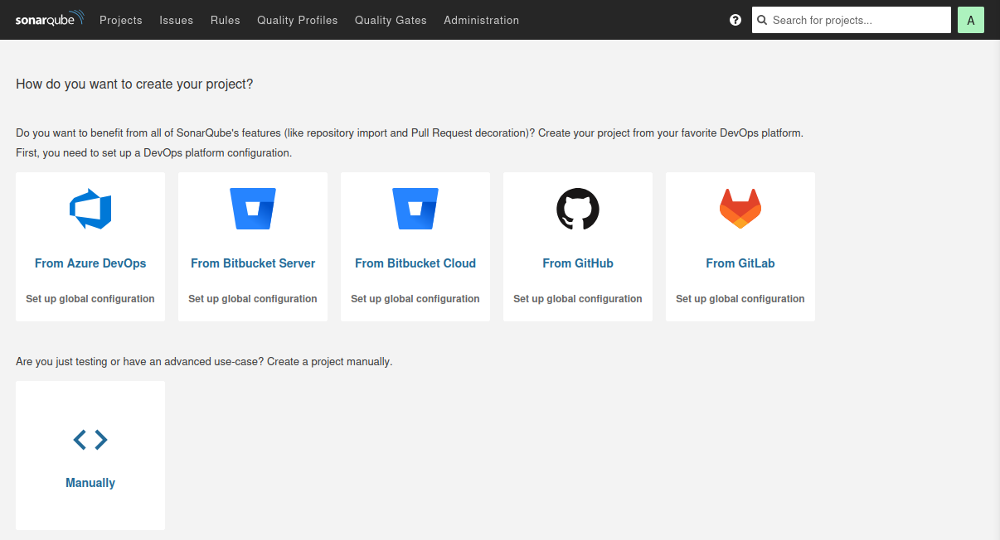
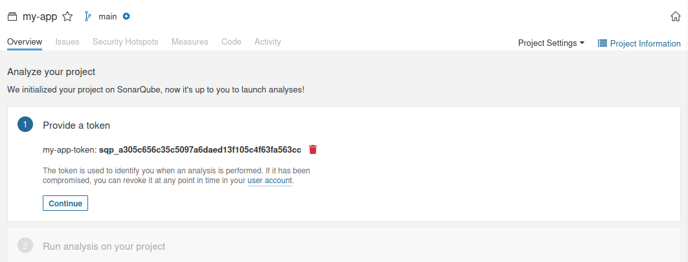
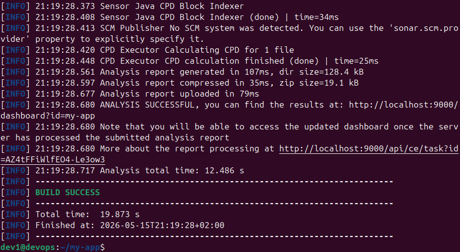
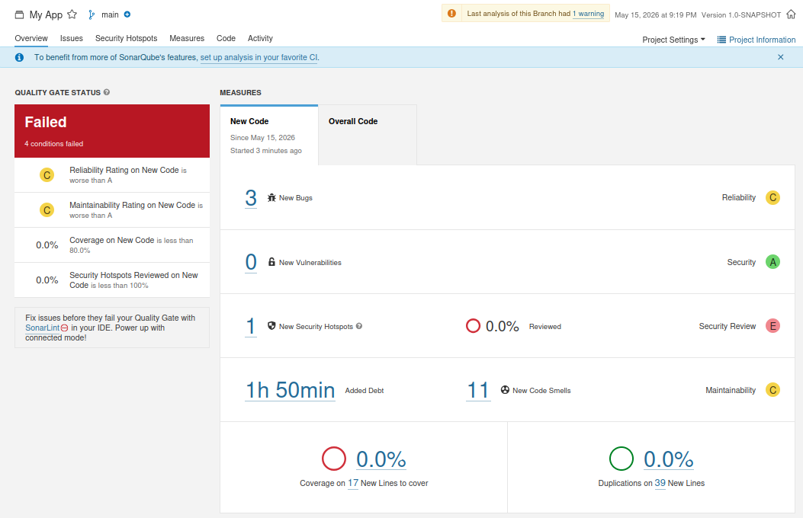

# LAB_SONARQUBE.md – Analyse de la Qualité du Code

> **Étudiant A – Expert SonarQube**
> **Projet : Construction d'une Chaîne CI/CD Sécurisée**  
> Classe : Mastère CCDAD – M1 | Enseignant : Hedi MAGROUN

---

## Objectif du lab

Le but de ce laboratoire est de découvrir comment SonarQube permet de détecter automatiquement les bugs, les vulnérabilités et les “code smells” dans une application Java utilisant Maven.

Nous allons créer un petit projet de test avec des erreurs intentionnelles pour voir comment SonarQube les détecte et les remonte.

---

## 1. Pourquoi analyser le code ?

Dans un projet logiciel, certains problèmes ne sont pas visibles immédiatement :

- des **bugs** pouvant faire planter l’application ;
- des **failles de sécurité** que des attaquants pourraient exploiter ;
- de la **dette technique**, c’est-à-dire du code compliqué à comprendre ou modifier ;
- du **code dupliqué**, rendant la maintenance plus difficile.

Sans outil d’analyse, on découvre souvent ces problèmes trop tard, après la mise en production, ce qui rend les corrections coûteuses.

**SonarQube** nous aide à détecter ces problèmes avant qu’ils ne deviennent critiques, grâce à une analyse **statique** du code et un tableau de bord centralisé.

### Ce que ça change concrètement

| Avant SonarQube                  | Avec SonarQube                  |
|---------------------------------|--------------------------------|
| Bugs détectés en production      | Détectés dès le commit          |
| Failles de sécurité ignorées     | Identifiées et classées par gravité |
| Code difficile à maintenir       | Dette technique mesurée         |
| Pas de standard de qualité       | Quality Gates appliqués         |

---

## 2. Concepts de base

### 2.1 Quality Gate

Un **Quality Gate** est un ensemble de règles qui décide si le projet est assez “propre” pour être déployé.  

- **PASS** → le code peut continuer dans le pipeline.  
- **FAIL** → le pipeline est bloqué.

Exemple de règles :

| Critère               | Seuil minimum |
|-----------------------|---------------|
| Bugs critiques        | 0             |
| Vulnerabilities       | 0             |
| Couverture de tests   | ≥ 80%         |
| Duplication de code   | < 5%          |

### 2.2 Clean as You Code

SonarSource recommande de contrôler **seulement le nouveau code**, plutôt que de tout analyser à chaque fois.  

Ça permet de ne pas se focaliser sur la vieille dette technique déjà existante et de garder le nouveau code propre dès le départ.

### 2.3 Les Scanners

Un **Scanner** lit le code source et envoie les résultats au serveur SonarQube.

| Scanner                  | Quand l’utiliser                   |
|--------------------------|------------------------------------|
| `sonar-maven-plugin`     | Projets Java/Maven                 |
| `sonar-scanner` CLI      | Tout type de projet                |
| SonarScanner for Gradle  | Projets Gradle                     |
| SonarScanner for Jenkins | Intégration CI/CD                  |

### 2.4 Types de problèmes détectés

| Type                 | Description                               | Exemple                              |
|----------------------|-------------------------------------------|--------------------------------------|
| **Bug**              | Erreur logique pouvant causer un crash    | `NullPointerException`               |
| **Vulnerability**    | Faille de sécurité exploitable            | SQL Injection                        |
| **Code Smell**       | Mauvaise pratique nuisant à la lisibilité | Variable inutilisée, catch vide      |
| **Security Hotspot** | Code à risque nécessitant une revue       | Mot de passe hardcodé                |

### 2.5 Comment ça fonctionne ? 

```
Code Source (Java/Maven)
        │
        ▼
sonar-maven-plugin (Scanner)
        │  analyse statique locale
        ▼
SonarQube Server (port 9000)
        │  applique les règles & Quality Gate
        ▼
Dashboard Web → résultats visibles
```

**Sources officielles :**
- [Documentation SonarQube](https://docs.sonarsource.com/sonarqube/latest/)
- [Quality Gates](https://docs.sonarsource.com/sonarqube/latest/user-guide/quality-gates/)
- [Clean as You Code](https://docs.sonarsource.com/sonarqube/latest/user-guide/clean-as-you-code/)
- [SonarScanner for Maven](https://docs.sonarsource.com/sonarqube/latest/analyzing-source-code/scanners/sonarscanner-for-maven/)

---

## 3. Mise en Place Technique – Installation

### 3.1 Prérequis

Avant de commencer, les prérequis suivants doivent être installés :

- Docker
- Java JDK 11 ou +
- Maven

Vérifiez avec :

```bash
docker --version
java -version
mvn -version
```

### 3.2 Lancer SonarQube avec Docker

Nous allons démarrer SonarQube dans un conteneur Docker. Pour ne pas perdre nos données (projets, analyses, Quality Gates…), nous créons d’abord un volume Docker persistant :

```bash
docker volume create sonarqube_data
```

Puis, on lance SonarQube :

```bash
docker run -d \
  --name sonarqube \
  -p 9000:9000 \
  -v sonarqube_data:/opt/sonarqube/data \
  sonarqube:lts
```

Vérifiez que le conteneur tourne :

```bash
docker ps
```

Le serveur SonarQube peut prendre environ 1 minute pour démarrer complètement. Ensuite, accédez à :

```
http://@IP:9000
```

- **Login par défaut** : `admin / admin`
- **Important** : changez le mot de passe dès le premier login pour sécuriser votre instance.

<p align="center">
  
</p>

### 3.3 Créer le projet et le token

1. Aller dans **Projects → Create Project → Manually**
2. Choisir **Project Key** : `my-app` et **Display Name** : `my-app`
3. Cliquer sur **Set Up → Locally**
4. Générer un token d’accès → nommer : `my-app-token`
5. Copier et sauvegarder ce token, il ne s’affiche qu’une seule fois !

<p align="center">
  
</p>

---

## 4. Analyse d'un petit projet Java

### 4.1 Structure

Nous allons créer un projet simple pour tester SonarQube :

```
my-app/
 ├── pom.xml
 └── src/main/java/App.java
```

### 4.2 Code de test (avec erreurs volontairement)

Le fichier `App.java` contient volontairement plusieurs erreurs et mauvaises pratiques pour observer ce que SonarQube détecte :

```java
import java.util.Scanner;

public class App {

    public static void main(String[] args) {

        Scanner scanner = new Scanner(System.in);

        // CODE SMELL : variable inutilisée
        int unusedVariable = 100;

        System.out.println("Enter username:");
        String username = scanner.nextLine();

        // BUG : mauvaise comparaison de chaînes
        if (username == "admin") {
            System.out.println("Welcome Admin");
        }

        if (username == "admin") {
            System.out.println("Welcome Admin");
        }

        // BUG : risque de NullPointerException
        String password = null;
        System.out.println(password.length());

        // VULNERABILITY : mot de passe hardcodé dans le code source
        String password2 = "admin123";

	try {
	    // BUG volontaire pour tester SonarQube : division par zéro
	    int result = 10 / 0;
	} catch (Exception e) {
	    // Exception ignorée (Code Smell)
	}
    // CODE SMELL
    if (true) {
        System.out.println("Always executed block");
    }
	// CODE SMELL : Scanner jamais fermé → fuite de ressource
    }
}
```

### 4.3 Configuration Maven

Pour analyser notre projet avec SonarQube, nous utilisons le plugin Maven suivant dans pom.xml :

```xml
<project>
    <modelVersion>4.0.0</modelVersion>
    <groupId>com.example</groupId>
    <artifactId>my-app</artifactId>
    <version>1.0-SNAPSHOT</version>
    <name>My App</name>

    <build>
        <plugins>
            <plugin>
                <groupId>org.sonarsource.scanner.maven</groupId>
                <artifactId>sonar-maven-plugin</artifactId>
                <version>4.0.0.2929</version>
            </plugin>
        </plugins>
    </build>

</project>
```

### 4.4 Lancer l'analyse

Pour analyser le projet et envoyer les résultats à SonarQube, nous exécutons :

```bash
mvn clean verify sonar:sonar \
  -Dsonar.projectKey=my-app \
  -Dsonar.host.url=http://@IP:9000 \
  -Dsonar.login=MON_TOKEN_ICI
```

| Argument               | Rôle                                           |
|------------------------|------------------------------------------------|
| `clean`                | Supprime les anciens fichiers compilés         |
| `verify`               | Compile le code et exécute les tests           |
| `sonar:sonar`          | Lance l'analyse et envoie les résultats        |
| `-Dsonar.projectKey`   | Identifiant du projet dans SonarQube           |
| `-Dsonar.host.url`     | URL du serveur SonarQube                       |
| `-Dsonar.login`        | Token d'authentification généré à l'étape 3.3  |

---

## 5. Test et Validation

### 5.1 Résultats

Après l’analyse, SonarQube remonte différents problèmes détectés dans notre code :

- Comparaison `==` sur String → Bug
- `NullPointerException` sur `password.length()`  → Bug
- Mot de passe hardcodé (`password2 = "admin123"`) → Security Hotspot
- Variable `unusedVariable` inutilisée  → Code Smell
- Bloc `catch` vide → Code Smell
- `Scanner` jamais fermé → Code Smell
- Duplication de code (`if (username == "admin")`) → Code Smell

→ **Quality Gate : FAIL**

<p align="center">
  
</p>

<p align="center">
  
</p>

### 5.2 Vérification dans le dashboard

Pour explorer les résultats :

1. Aller sur `http://@IP:9000`
2. Cliquer sur **Projects → my-app**
3. Observer :
    - Statut du **Quality Gate**
    - Nombre de **Bugs, Vulnerabilities, Code Smells**
    - Détail par fichier et par ligne de code

> Le dashboard permet de naviguer directement vers les lignes problématiques et de comprendre exactement ce qui doit être corrigé.

---

## 6. Intégration CI/CD avec Jenkins et SonarQube

Dans une chaîne CI/CD, SonarQube peut être intégré avec Jenkins afin d’automatiser l’analyse de qualité du code à chaque build.

Cette intégration permet de :

- lancer automatiquement l’analyse statique ;
- vérifier le Quality Gate ;
- bloquer le pipeline si la qualité du code est insuffisante.

### 6.1 Plugins Jenkins nécessaires

Les plugins Jenkins suivants doivent être installés :

- SonarQube Scanner for Jenkins
- Pipeline
- Credentials Plugin

### 6.2 Configuration SonarQube dans Jenkins

Dans Jenkins :

1. Aller dans **Manage Jenkins → Configure System**
2. Chercher la section **SonarQube Servers**
3. Ajouter un serveur SonarQube :

| Champ | Valeur |
|---|---|
| Name | `SonarQube` |
| Server URL | `http://sonarqube:9000` |

### 6.3 Stages Jenkinsfile

Dans le pipeline Jenkins, nous ajoutons les stages suivants :

```groovy
stage('SonarQube Analysis') {
  steps {
    dir('app') {
      withSonarQubeEnv('SonarQube') {
        sh 'mvn sonar:sonar -Dsonar.projectKey=CI-CD-Project'
      }
    }
  }
}

stage('Quality Gate') {
  steps {
    waitForQualityGate abortPipeline: true
  }
}
```

### 6.4 Explication des stages

| Stage | Description |
|---|---|
| `SonarQube Analysis` | Lance l’analyse statique avec Maven |
| `withSonarQubeEnv` | Injecte automatiquement la configuration SonarQube |
| `waitForQualityGate` | Attend le résultat du Quality Gate |
| `abortPipeline: true` | Stoppe le pipeline si le Quality Gate échoue |

### 6.5 Fonctionnement du pipeline

```text
Developer Push
       │
       ▼
     Jenkins
       │
       ▼
 Maven Build
       │
       ▼
 SonarQube Analysis
       │
       ▼
 Quality Gate
   │         │
 PASS      FAIL
   │         │
   ▼         ▼
 Deploy    Pipeline Stopped
```

Cette intégration permet d’assurer automatiquement la qualité du code avant le déploiement de l’application.

---

## 7. Troubleshooting

### 7.1 Timeout : Socket closed

Si l'analyse échoue avec une erreur `Socket closed`, vérifiez :

- la connectivité entre Jenkins et le serveur SonarQube ;
- l'URL de SonarQube :
  - `http://sonarqube:9000` pour Docker interne ;
  - `http://@IP:9000` depuis l'extérieur ;
- le temps d'attente du stage `waitForQualityGate`.

### 7.2 Mémoire insuffisante

Vérifiez l'utilisation mémoire du conteneur SonarQube :

```bash
docker stats sonarqube
```

Si la mémoire est insuffisante, augmentez la mémoire disponible pour Docker ou Java.

### 7.3 vm.max_map_count

Pour corriger les problèmes liés à `vm.max_map_count`, exécutez :

```bash
sudo sysctl -w vm.max_map_count=262144
```

### 7.4 Contrôles système

```bash
df -h
docker stats
docker logs -f sonarqube
```